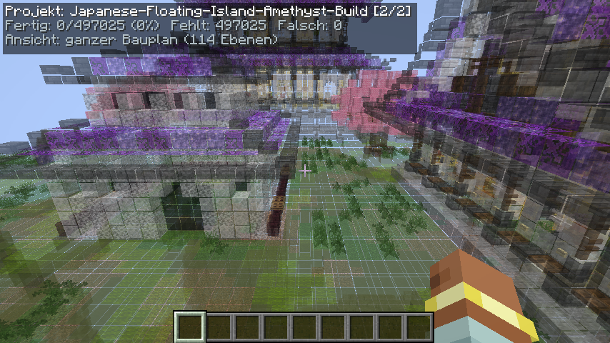
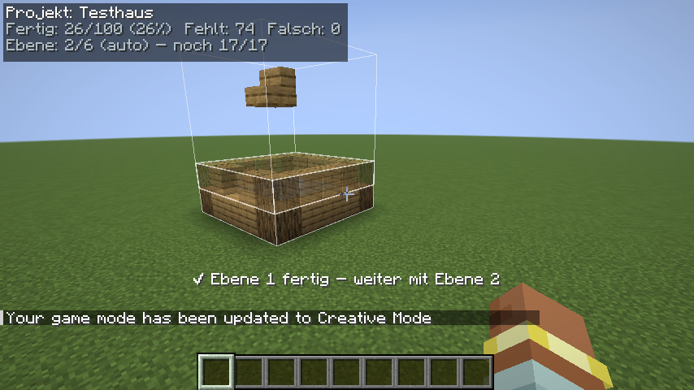
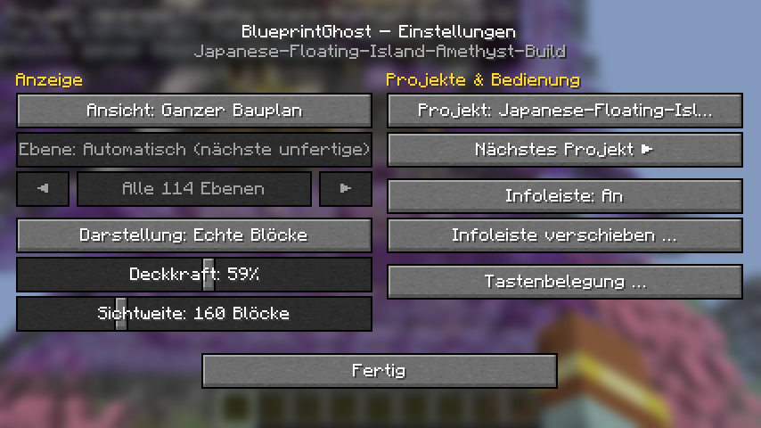
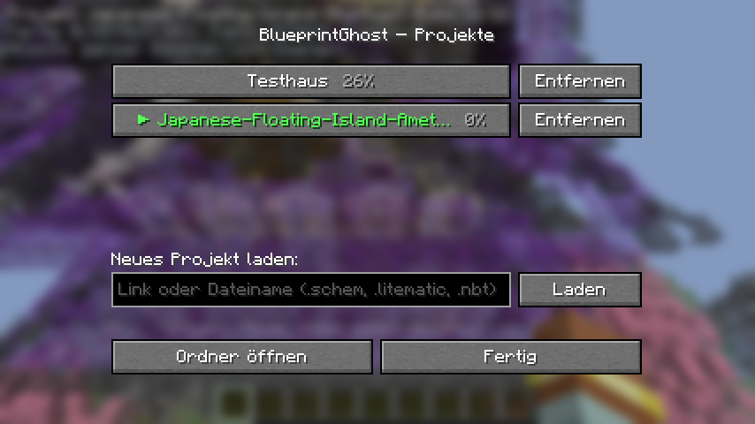

# BlueprintGhost – Baupläne im Spiel nachbauen

Fabric-Mod für **Minecraft 26.3** (läuft in Lunar Client mit Fabric). Lade einen Bauplan aus dem Internet,
und im Spiel siehst du als Geister-Blöcke, welcher Block wohin muss.



| Ebene für Ebene | Einstellungen (Taste K) | Projekte |
|---|---|---|
|  |  |  |

## Installation in Lunar Client

1. Lunar Launcher öffnen → Version **26.3** → Loader **Fabric** wählen.
2. Die `.jar` (aus den [Releases](https://github.com/Forg1ve/blueprintghost/releases), selbst gebaut unter `build/libs/`
   oder aus dem *Actions*-Tab → letzter Build → *Artifacts*) in den Mod-Ordner kopieren:
   - **Windows:** `%USERPROFILE%\.lunarclient\profiles\26\mods\fabric-26.3\`
   - **macOS:** `~/.lunarclient/profiles/26/mods/fabric-26.3/`
     (im Finder: *Gehe zu → Gehe zum Ordner …* ⇧⌘G, Pfad einfügen – der Ordner ist versteckt)

   Fabric API ist dort bereits vorhanden. Nur **eine** BlueprintGhost-Version in den Ordner legen.
3. Spiel starten. In der Mod-Liste sollte „BlueprintGhost“ auftauchen.

## Benutzung

| Befehl | Was er macht |
|---|---|
| `/bp load <URL>` | Bauplan herunterladen und laden. Die Ecke landet an deinen Füßen. |
| `/bp load <Datei>` | Bauplan aus dem Ordner laden (Tab ergänzt Dateinamen) |
| `/bp list` / `/bp folder` | Baupläne anzeigen / Bauplan-Ordner im Explorer bzw. Finder öffnen |
| `/bp here` | Bauplan an deine aktuelle Position verschieben |
| `/bp move <dx> <dy> <dz>` | Verschieben, z.B. `/bp move 0 -1 0` |
| `/bp pos <x> <y> <z>` | Ecke auf feste Koordinaten setzen |
| `/bp rotate [rechts\|links\|180]` | Drehen |
| `/bp mirror <x\|z\|aus>` | Spiegeln |
| `/bp settings` (Taste `K`) | Einstellungsmenü: Ansicht, Ebene, Darstellung, Deckkraft, Sichtweite, Projekte, Infoleiste, Tasten |
| `/bp projects` | Alle Projekte anzeigen (anklicken zum Wechseln) |
| `/bp switch <name>` / `/bp remove <name>` | Projekt wechseln / aus der Liste entfernen |
| `/bp hud <an\|aus\|verschieben\|reset>` | Infoleiste ein-/ausblenden, verschieben, zurücksetzen |
| `/bp view <ganz\|ebenen>` | Ganzer Bauplan oder Ebene für Ebene |
| `/bp layer <auto\|nummer\|hoch\|runter>` | Ebene wählen – `auto` = unterste unfertige |
| `/bp materials [alle\|ebene]` | Fehlende Blöcke mit Anzahl + Inventar (im Ebenen-Modus: nur aktuelle Ebene) |
| `/bp style <modell\|kasten>` | Geister als echte Blöcke oder Kästen |
| `/bp alpha <10-100>` / `/bp radius <4-512>` | Deckkraft / Sichtweite |
| `/bp toggle`, `/bp info`, `/bp clear` | `clear` entfernt das aktuelle Projekt |

**Tasten** – alle änderbar im Menü unter **Einstellungen → Tastenbelegung …** (oder in den Minecraft-Steuerungsoptionen):

| Aktion | Windows/Linux | macOS |
|---|---|---|
| Einstellungen öffnen | `K` | `K` |
| Bauplan ein/aus | `N` | `N` |
| Ebene hoch / runter | `Bild ↑` / `Bild ↓` | `↑` / `↓` (Pfeiltasten) |
| Ganzer Bauplan ⇄ Ebene für Ebene | `Pos1` | `J` |

Auf dem Mac werden Pfeiltasten und `J` verwendet, weil Mac-Tastaturen meist kein Bild↑/Bild↓/Pos1 haben.

**Ebene für Ebene:** Es wird nur eine Ebene gezeigt. Im Modus *automatisch* springt die Anzeige zur nächsten
Ebene, sobald die aktuelle fertig ist (mit Meldung und Ton). Das HUD zeigt „Ebene 5/114 – noch 23/80“.
Die Einstellung bleibt gespeichert und gilt auch für neu geladene Baupläne.

**Anzeige:** Fehlende Blöcke erscheinen als halbtransparente echte Blöcke (auch nachts hell), bis 160 Blöcke weit.
🟥 rot = falscher Block · 🟨 gelb = richtiger Block, falsch gedreht.
`/bp style kasten` schaltet auf einfache blaue Kästen um, `/bp alpha <10-100>` ändert die Deckkraft,
`/bp radius <n>` die Sichtweite (bei Rucklern verkleinern).
Schaust du auf eine Stelle, zeigt das Panel oben links den Block, seine Ausrichtung und ob du ihn in der Hotbar hast.

**Projekte:** Jeder geladene Bauplan wird ein Projekt mit eigener Position, Drehung und Ebene. Über
*Einstellungen → Projekt* (Liste, Wechseln, Entfernen, neuen Link/Dateinamen laden) oder *Nächstes Projekt ▶*
wechselst du zwischen ihnen. Alles bleibt nach einem Neustart erhalten.

**Infoleiste:** Unter *Einstellungen → Infoleiste verschieben …* mit der Maus an jede Stelle ziehen oder per Knopf
in eine Ecke setzen; dort und mit `/bp hud aus` lässt sie sich auch ganz abschalten.

## Unterstützte Formate

- `.litematic` (Litematica) · `.schem` (WorldEdit/FAWE, Sponge v1–v3) · `.nbt` (Konstruktionsblock)
- ZIP-Archive mit einer dieser Dateien darin
- Altes `.schematic` (MCEdit, vor 1.13) **nicht** – in WorldEdit als `.schem` neu speichern.

## Wo gibt's Baupläne?

Seiten wie Planet Minecraft, minecraft-schematics.com, abfielder.com oder GitHub. Wichtig: der Link muss
direkt auf die **Datei** zeigen (Rechtsklick auf „Download“ → Link kopieren). GitHub-, Dropbox- und
Google-Drive-Freigabelinks werden automatisch umgewandelt. Klappt ein Download nicht (Login/Captcha auf der
Seite), die Datei im Browser laden und in den Ordner (`/bp folder`) legen.

## Selbst bauen

Benötigt ein **JDK 25** (z.B. [Temurin](https://adoptium.net)).

Windows:
```
set JAVA_HOME=<Pfad zu JDK 25>
gradlew build
```

macOS / Linux:
```
export JAVA_HOME=$(/usr/libexec/java_home -v 25)   # macOS; unter Linux Pfad zum JDK
./gradlew build
```

Die fertige Datei liegt danach in `build/libs/`. GitHub baut die Mod bei jedem Push automatisch auf
Linux, Windows **und macOS**.

## Automatischer Bildtest

`gradlew runClientGameTest` startet eine Testwelt, lädt ein Testhaus und (falls in Downloads vorhanden) die
Japanese-Floating-Island und speichert Screenshots unter `build/run/clientGameTest/screenshots`.
